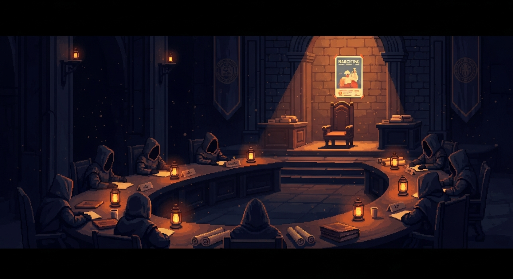
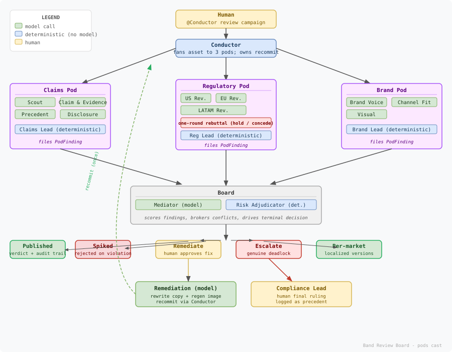
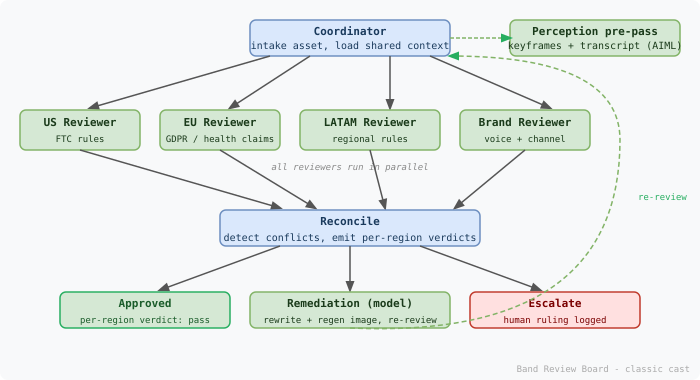

<p align="center"><a href="https://pablo-oss.vercel.app/band-of-agents"></a></p>

<h1 align="center">Band Review Board</h1>

<p align="center"><em>Specialist agents clear a marketing campaign against every target market's ad rules before it publishes, and prove each verdict.</em></p>

<p align="center">
  
  
  
  
  
  
  
  
  
  
</p>

<p align="center">
  
  
  <a href="https://pablomanjarres.com/portfolio/projects/band-of-agents"></a>
  <a href="https://pablo-oss.vercel.app/band-of-agents"></a>
</p>

<p align="center">
  <a href="https://artifact-viewer-one.vercel.app"></a>
</p>

A marketing-compliance review board built on [band.ai](https://band.ai). A brand ships a whole campaign (one product with many materials: video, posts, images, banners) into a shared Band room, and specialist agents clear each material against every target market's advertising and regulatory rules before it publishes. They catch the cross-border conflicts a single legal team tends to miss, and every verdict traces back to a rule and an agent.

Built for the [Band of Agents Hackathon](https://lablab.ai) (lablab.ai), June 2026. Solo build.

> The compliance content here is a hackathon demo. It is not legal advice.

## Highlights

- **Agent-to-agent debate.** In the regulatory pod, when two region reviewers block the same span, the Reg Lead runs a one-round rebuttal: each blocking region holds or concedes, on the record, before anything consolidates.
- **Two casts on one domain.** A pods cast (17 agents plus a human) drives the live Band.ai room. A lighter classic cast backs the web console's "Run review" button.
- **Campaign-level review.** A campaign is a product with many materials (a hero video that owns its cutdown posts and thumbnail, standalone posts, banners), each negotiated per region concurrently.
- **Cascading dossier.** One shared source of approved claims and substantiation grounds every reviewer. Edit it once and every material re-grounds.
- **Multimodal perception.** A pre-pass samples video keyframes and transcribes audio, then hands the text to every reviewer.
- **Multi-model fleet.** Each agent runs the model family that fits its job. `MODEL_MODE` switches the whole fleet (`vertex` / `aiml` / `dev`) behind one interface.
- **Auditable decisions.** Routing and the final verdict (Conductor, pod leads, Risk Adjudicator) run deterministically, with no model in the loop.
- **Runs with no keys.** The full pods debate runs end to end on an in-process fake transport with stub models. No API keys, no Band account.

## Why it matters

A marketing claim that clears in one country can be illegal in another. The same asset sold into several markets carries stacked liability, because each jurisdiction sets its own rules, ceilings, and required disclosures. That stacked conflict is what these agents surface and what a single reviewer tends to miss.

The downside is concrete:

- GDPR fines up to 20 million euro or 4% of global turnover.
- The UK DMCC Act up to 10% of global turnover.
- US FTC penalties per violation on unsubstantiated claims, where one campaign is many violations.

Six markets used to mean a week or more of review each, with an uncapped fine if one line slipped. Here it takes minutes, with one human ruling on the genuine judgment call and every verdict traceable to a rule and an agent.

## Where the agents disagree

The hard part is the conflict between mandates. Each agent holds an objective that can collide with another's, and the board has to reconcile them:

- A quantified or efficacy claim ("clinically proven to boost your immune system") can pass in the US with substantiation and be an unauthorized health claim in the EU.
- An EU fix can require a disclosure or consent line the US version never needed.
- A localized rewrite that fixes the legal problem can drift off-brand, and the brand reviewers push back.

So the reviewers negotiate the tradeoff instead of merging a checklist. In the regulatory pod, when two region reviewers block the same span, the Reg Lead runs a one-round rebuttal: each blocking region holds or concedes, on the record, before anything consolidates. Band is the layer this happens on. Every agent is a full participant in the room, coordinates by @mention, and narrates its reasoning as it goes.

Two casts run on the same domain and the same Band layer:

- **Pods cast** (the live workflow): 17 agents plus a human, in three deliberating pods on a deterministic decision sequence. Connect it with `pnpm agents`.
- **Classic cast** (the web console): Coordinator to US / EU / LATAM / Brand to Reconcile, emitting per-region verdicts. It backs the console's "Run review" button, reached with `pnpm serve`, `pnpm serve:band`, or `pnpm agents:classic`.

## How it works

The headline design is blackboard pods on a deterministic decision sequence. Three specialist pods deliberate on a shared board, then a fixed order of deterministic steps (Conductor, the pod leads, the Risk Adjudicator) drives the asset to a terminal state: published, spiked, remediated, or escalated to the human. The pod members, the Mediator, and Remediation call models; the steps that decide the outcome do not, so routing and the verdict stay auditable.

<p align="center"></p>

<details>
<summary><strong>Classic cast</strong> (the web console's "Run review" flow)</summary>

<p align="center"></p>

</details>

### Modules

```
src/
  agents/      the pods cast and the classic cast (conductor, pod leads,
               knowledge sources, region + brand reviewers, mediator,
               remediation, risk adjudicator, reconcile)
  band/        band.ai transport (real) and an in-process fake for tests
  board/       shared board, board + campaign sessions, the pods session
  domain/      campaign / asset / rulebook / finding types, rulebook import
  models/      ModelClient (text + image blocks) and MODEL_MODE routing
  perception/  multimodal pre-pass (keyframes, vision, transcript)
  store/       file-backed store for reviews, campaigns, and runs
  server/      Hono HTTP + SSE backend for the web console
  run/         local demos, the real-agent runners, smoke tests
```

## The cast

The live pods cast is 17 agents plus a human (the Compliance Lead).

| Agent | Objective | Calls a model |
|---|---|---|
| Conductor | Fan the asset to the three pods, own the single recommit; the only agent a human tags | No (deterministic) |
| Scout | Map the risky surfaces (claims, CTAs, image) as work-items | Yes |
| Claim & Evidence | Flag claims not substantiated by the asset | Yes |
| Precedent | Attach relevant prior rulings | Yes |
| Disclosure | Draft any mandatory disclosure text | Yes |
| US / EU / LATAM reviewers | Check against each market's rulebook; in the Reg pod, hold or concede a contested span in the rebuttal round | Yes |
| Brand Voice / Channel Fit / Visual | Keep copy, format, and image on-brand | Yes |
| Claims / Regulatory / Brand Leads | Collect positions, run the rebuttal (Reg Lead), file one consolidated finding | No (deterministic) |
| Mediator | Broker a cross-pod conflict into the smallest resolution, or report a deadlock | Yes |
| Remediation | Rewrite blocked copy and regenerate a localized image, recommit | Yes |
| Risk Adjudicator | Score the board, run the mediation/remediation cycle, drive the terminal decision, summon the human | No (deterministic) |
| Compliance Lead | Rule on the genuine deadlock; ruling logged as precedent | Human, not an agent |

The orchestration steps (Conductor, pod leads, Risk Adjudicator) are deterministic on purpose, so routing and the verdict logic stay auditable rather than left to a model. The classic cast keeps the same discipline: its coordinator and reconcile steps are deterministic too.

## Campaigns and multimodal review

A review is not limited to one asset. A campaign is a product with many materials (a hero video that owns its cutdown posts and thumbnail, standalone posts, banners). Each material is negotiated per region concurrently, and the campaign verdict is an observation over the per-material verdicts (worst-case per region plus a material x region matrix).

- **Cascading dossier:** a campaign carries a shared source of truth (approved claims, substantiation, approved info, uploaded sources) that cascades into every reviewer's prompt. Edit it once and it re-grounds every material.
- **Multimodal perception:** a pre-pass reads each video and image (sampled keyframes) and hears the audio (transcript) via AIML, then feeds those text artifacts to every reviewer.
- **Rulebook smart import:** upload a `.md` (parsed into rules by a model) or `.json` rulebook, or apply a curated preset, instead of entering rules one by one.

Full details in [`docs/CAMPAIGNS.md`](docs/CAMPAIGNS.md).

## Multi-model routing

Each model-calling agent runs the family that fits its job. `MODEL_MODE` switches the whole fleet behind one interface (`src/models/route.ts`).

| Agent | `aiml` (main path) | `dev` (cost-saver) |
|---|---|---|
| Scout, LATAM | Llama 3.1 8B | Llama 3.1 8B (Featherless, open model) |
| US reviewer | OpenAI GPT-5 | Claude Sonnet (Bedrock) |
| EU reviewer, Claim & Evidence | Gemini 2.5 Pro | Gemini (Vertex) |
| LATAM reviewer | Llama 3.1 8B | Llama 3.1 8B (Featherless) |
| Precedent, Channel, Visual | Gemini 2.5 Flash | Gemini (Vertex) |
| Disclosure | Claude Sonnet | Claude Sonnet (Bedrock) |
| Brand reviewer / Brand Voice | Claude Haiku 4.5 | Claude Haiku (Bedrock) |
| Mediator | Claude Opus | Claude Opus (Bedrock) |
| Remediation (copy) | DeepSeek | Claude Sonnet (Bedrock) |
| Remediation (image) | Gemini 2.5 Flash Image ("Nano Banana") | Gemini (Vertex) |
| Perception (vision) | vision-capable model, reads keyframes/images | (MODEL_MODE fallback) |
| Perception (audio) | Whisper-class transcription | (MODEL_MODE fallback) |

- `vertex` routes the whole fleet through GCP Vertex (Gemini) on one credential, the path used to stand up the live 17-agent Band.ai room with the least setup.
- `aiml` routes every agent through the [AI/ML API](https://aimlapi.com) OpenAI-compatible gateway, used for the headline calls and the Nano Banana image work.
- `dev` spreads volume across AWS Bedrock, GCP Vertex, and [Featherless](https://featherless.ai) so the small AIML credit is not burned during development.
- All three modalities run through AIML: text (the reviewers), image (Nano Banana plus perception vision), and audio (perception transcription).

## A live run

On real models the sample asset drives the full negotiation, and nothing about the outcome is hard-coded, so it varies run to run. A representative run:

```
Reg Lead: regulatory pod deliberating (3 members)
EU Reviewer rebuts on "clinically proven to boost your immune system": hold
EU Reviewer rebuts on "9 out of 10 users felt healthier in two weeks": hold
Reg Lead: regulatory pod: 8 findings, 3 conflict(s)
Risk Adjudicator: 3 conflict(s), consulting mediator
Mediator: no movement
Risk Adjudicator: remediate (attempt 1)
... asset recommits, pods re-deliberate ...
Risk Adjudicator: deadlock, escalating
Human ruling: spiked      ->      terminal: spiked
```

The EU reviewer holds its block on rebuttal, the pod files a real cross-region conflict, the board fails to mediate it, one remediation cycle runs, and the deadlock escalates to the human.

## Getting started

Prereqs: Node 22+ and pnpm.

### Run it with no keys

The full pods debate runs end to end on an in-process fake transport with stub models, so it works with no API keys and no Band account:

```bash
pnpm install
pnpm test          # full suite: fake transport, routing, perception stubs
pnpm typecheck
pnpm local pods    # the pods -> board -> decision walk on the sample asset
pnpm local         # the Immune+ campaign, materials negotiated concurrently
pnpm local single  # the legacy single-asset debate, for comparison
```

### Run it on real models

The live Band.ai room (the pods cast, 17 agents on one GCP credential):

```bash
MODEL_MODE=vertex pnpm agents
```

Create a Band room, add one External agent per handle in app.band.ai plus a human (the Compliance Lead), paste each UUID and API key into `.env`, then post `@Conductor review <campaign name>`. The handles: `@conductor`, `@scout`, `@claim-evidence`, `@precedent`, `@disclosure`, `@reg-lead`, `@claims-lead`, `@brand-lead`, `@us-reviewer`, `@eu-reviewer`, `@latam-reviewer`, `@brand-voice`, `@channel`, `@visual`, `@mediator`, `@remediation`, `@adjudicator`.

The web console (classic cast, real models streamed over SSE, no Band account):

```bash
MODEL_MODE=dev BOARD_MODE=local pnpm serve   # open http://localhost:8787
pnpm serve:band                              # the console driving a live band.ai room
pnpm agents:classic                          # the classic cast in a band.ai room
```

`MODEL_MODE` picks the fleet: `vertex` (all Gemini on one GCP credential), `aiml` (the AI/ML API gateway, needs `AIML_API_KEY`), or `dev` (spread across Bedrock + Vertex + Featherless). Setup notes live in [`docs/LIVE_BAND.md`](docs/LIVE_BAND.md) and [`docs/AIML_SWITCHOVER.md`](docs/AIML_SWITCHOVER.md).

## What's inside

One package for the review engine plus a separate web console, no workspace magic.

| Path | What it holds |
|---|---|
| `src/` | The review engine: agents, board sessions, domain types, the `ModelClient` and `MODEL_MODE` routing, multimodal perception, the file-backed store, and the Hono server. TypeScript, Node 22, ESM. |
| `web/` | The campaign console: React 18 + Tailwind + Vite, talking to the server over SSE (campaigns, the material x region matrix, the analyzing panel, the rulebook editor, the pods diagram). |
| `assets/` | The domain data the agents reason over (see below), plus `pods-flow.svg` and `classic-flow.svg`. |
| `docs/` | `CAMPAIGNS.md` (campaigns + multimodal), `LIVE_BAND.md` (standing up the live room), `AIML_SWITCHOVER.md`, and setup notes. |
| `test/` | The Vitest suite: walking-skeleton rungs, the pods and classic casts, campaigns, rulebook import, perception, and routing, all on the fake transport. |
| `ARCHITECTURE.md` | The long-form design write-up. |

The shared context in `assets/` that grounds every reviewer:

- `brand-dna.json`: voice, approved and forbidden vocabulary, claim boundaries, channel norms.
- `rulebook.us.json`, `rulebook.eu.json`, `rulebook.latam.json`: the per-market rules each region reviewer applies.
- `presets/rulebook.*.json`: curated rulebook presets (US FTC, EU health claims, LATAM) for one-click import.
- `sample-campaign.json`: the demo campaign, a product with a dossier and several materials including a hero video that owns its posts and thumbnail.
- `sample-asset.json`, `sample-asset-adapt.json`: the legacy single-asset demos, including one whose claim passes in one market and fails in another.

## Tech stack

TypeScript on Node 22+, pnpm, ESM. Agent coordination goes through `@band-ai/sdk` behind a transport seam (a real band.ai transport and an in-process fake for tests). Findings and verdicts are validated with `zod`. Model calls run through a provider-agnostic `ModelClient` (the `openai` SDK for the AIML gateway, `@anthropic-ai/bedrock-sdk`, `@google/genai`) over a `string | ContentBlock[]` message seam, so one call can carry image input. A Hono server streams each review to a React + Tailwind console over SSE. Tests run on Vitest.

## License

MIT. See [`LICENSE`](LICENSE).

---

<p align="center">
  <a href="https://pablo-oss.vercel.app/band-of-agents">Landing</a>
  &nbsp;&middot;&nbsp;
  <a href="https://pablomanjarres.com/portfolio/projects/band-of-agents">Portfolio write-up</a>
  &nbsp;&middot;&nbsp;
  <a href="https://artifact-viewer-one.vercel.app">Live demo</a>
  <br/>
  Built by <a href="https://pablomanjarres.com">Pablo Manjarres</a>
</p>
