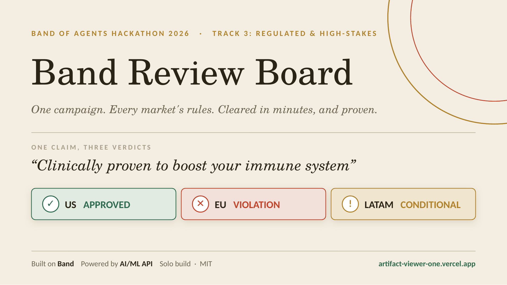

# Band Review Board

> One campaign, every market's rulebook, cleared by a room of agents that argue the conflicts out.


[](https://pablomanjarres.com/portfolio/projects/band-of-agents)

<p align="center">
  
</p>

A marketing-compliance review board built on [band.ai](https://band.ai). A brand ships a whole campaign (a product with many materials: a hero video, its cutdown posts, banners, images) into a shared Band room, and specialist agents clear each material against every target market's advertising and regulatory rules before it publishes. It catches the cross-border conflicts a single legal team misses, and proves every verdict with an audit trail.

Built solo for the [Band of Agents Hackathon](https://lablab.ai) (lablab.ai), June 2026.

**Hosted demo:** [artifact-viewer-one.vercel.app](https://artifact-viewer-one.vercel.app)

> The compliance content here is a hackathon demo, not legal advice.

## Why it is not a pipeline

The interesting part is the conflict, not the workflow. The agents hold competing mandates and have to reconcile them. A "clinically proven" efficacy claim can pass in the US with substantiation and be an unauthorized health claim in the EU. So the reviewers do not merge a checklist. In the Regulatory pod, when two region reviewers split on the same span (one blocks it, another clears it), the Reg Lead runs a one-round rebuttal where each blocking region **holds or concedes, on the record**, before anything consolidates. A conceded block drops to a warning; a held block is logged as a conflict. That negotiation is the point. Band is the layer it runs on: every agent is a first-class participant that coordinates by @mention and narrates its reasoning.

## Highlights

- **Real agent debate, not a merged checklist.** A `hold` / `concede` stance schema (`pod-region-reviewer.ts`) drives a cross-region rebuttal round when reviewers split on a span. A conceded block downgrades to a warning; a held block becomes a logged conflict. Nothing about the outcome is scripted.
- **Deterministic spine.** The Conductor, pod leads, and Risk Adjudicator call no model. Routing and the terminal verdict (published / spiked / escalated) are auditable, not left to an LLM.
- **Two topologies.** A pods cast (Claims / Regulatory / Brand pods on a decision spine, 17 agents at full size) and a lighter classic cast (coordinator to region + brand reviewers to reconcile). The live Band.ai room runs a compact 10-agent variant of the pods cast to fit the room's agent cap; the Regulatory pod keeps its full US/EU/LATAM debate.
- **Multi-model by design.** `MODEL_MODE` (`aiml` | `dev` | `vertex`) swaps the whole fleet behind one `ModelClient`. Each agent runs the family that fits its job: GPT-5 for claim reasoning, Gemini 2.5 Pro for strict rules, an open Llama, Claude (Haiku/Sonnet/Opus), DeepSeek for rewrites, and Nano Banana (Gemini's image model) for localized image regeneration. `MODEL_MODE=vertex` runs the entire fleet on one GCP credential.
- **Multimodal perception.** A pre-pass sees each video and image (ffmpeg-sampled keyframes) and hears the audio (Whisper-class transcript), then feeds the resulting text (description, on-screen text, detected claims, transcript) to every reviewer. Even a text-only region model benefits.
- **Cascading dossier.** A campaign carries approved claims and substantiation that cascade into every reviewer's prompt. Edit it once and it re-grounds every material, so a claim can publish in the US while the EU still demands a disclosure.

## How it works

```
src/
  agents/      pods cast (conductor, pod leads, pod members, mediator, risk
               adjudicator) + classic board (coordinator, region/brand
               reviewers, reconcile, remediation)
  band/        band.ai transport (real) and an in-process fake for tests
  board/       shared board, campaign sessions, the pods session, event model
  domain/      campaign / asset / rulebook / finding types, rulebook import, presets
  models/      ModelClient (text + image blocks), provider adapters, MODEL_MODE routing
  perception/  multimodal pre-pass (keyframes, vision, transcript)
  run/         local demos, the real-agent runner, smoke tests
  server/      Hono HTTP + SSE backend
assets/        brand DNA, per-region rulebooks, presets, sample campaign
web/           React + Tailwind console (campaigns, matrix, rulebook editor)
test/          53 Vitest files (pods, campaigns, routing, perception, and more)
```

Coordination runs through `@band-ai/sdk` behind a transport seam: a real band.ai transport in production, an in-process fake for tests. Findings and verdicts are validated with `zod`. A Hono server streams the review over SSE to the React console, which renders the live board and the material x region verdict matrix.

## Tech stack

TypeScript, Node 22+, pnpm, ESM. `@band-ai/sdk` for agent coordination, `hono` + `@hono/node-server` for the HTTP/SSE backend, `zod` for contracts. Model calls go through a provider-agnostic `ModelClient` over the `openai` SDK (the AIML gateway and Featherless), `@anthropic-ai/bedrock-sdk`, and `@google/genai` (Vertex), across a `string | ContentBlock[]` message seam so one call can carry image input. Frontend is React + Tailwind on Vite. Tested with Vitest (53 files).

## Getting started

The full pods debate runs end to end on an in-process fake transport, so you can see it work with no keys and no Band account:

```bash
pnpm install
pnpm test          # full suite, fake transport, no keys
pnpm typecheck
pnpm local pods    # pods -> board -> spine on the sample asset (full 17-agent cast)
pnpm local         # the Immune+ campaign, all materials negotiated concurrently
pnpm local single  # the legacy single-asset debate, for comparison
```

Run it against real models. The live band.ai room connects a compact 10-agent pods cast (drop the `compact` flag in `src/run/agents.ts` for the full 17):

```bash
MODEL_MODE=vertex pnpm agents   # whole fleet on Gemini/Vertex, one GCP credential
```

The classic cast backs the web console's "Run review" button (real models, no Band account):

```bash
MODEL_MODE=dev BOARD_MODE=local pnpm serve   # open http://localhost:8787
```

Minimal `.env` (copy from `.env.example`, never commit real keys):

```bash
MODEL_MODE=vertex                    # aiml | dev | vertex
GOOGLE_GENAI_USE_VERTEXAI=true       # Vertex via ADC (gcloud auth application-default login)
GOOGLE_CLOUD_PROJECT=your-gcp-project
GOOGLE_CLOUD_LOCATION=us-central1
AIML_API_KEY=                        # for MODEL_MODE=aiml
# Live band.ai room only: one External agent per handle (UUID + band_a_... key)
CONDUCTOR_AGENT_ID=
CONDUCTOR_API_KEY=band_a_...
```

## License

MIT. See `LICENSE`.

---

Built by Pablo Manjarres. More at [pablomanjarres.com/portfolio/projects/band-of-agents](https://pablomanjarres.com/portfolio/projects/band-of-agents).